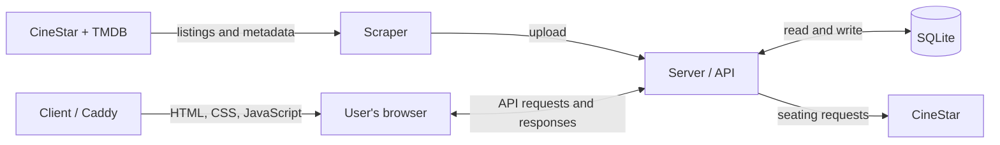

# BetterCinestar

BetterCinestar is a web app for browsing CineStar films and showtimes, filtering by cinema and date, and viewing seating availability. It combines CineStar listings with TMDB metadata such as ratings, posters, cast, and trailers.

## How it works

| Part | Responsibility | Technology |
| --- | --- | --- |
| `client/` | Browser interface; Caddy serves the Docker build. | Svelte 5, SvelteKit, Tailwind, Vite |
| `server/` | Provides the HTTP API, stores listings, and fetches seating on demand. | Node.js, Express, Sequelize, SQLite, Puppeteer |
| `scraper/` | Fetches CineStar listings, adds TMDB metadata, and uploads results to the server. | Node.js, Puppeteer, Axios, cron |
| `shared/` | Keeps cinema IDs, names, and cities consistent across all three apps. | JSON |



SQLite is managed by the server. Listings are refreshed by the scraper, not when someone opens the website.

## Run locally with Docker

Requires Docker Compose. Commands run from the repository root.

### 1. Prepare settings

Settings:

```bash
cp .env.example .env
```

`SCRAPER_SECRET` is required; placeholders are rejected. `TMDB_API_KEY` enables optional TMDB enrichment.

### 2. Start the server and interface

```bash
docker compose -f docker-compose.yml -f docker-compose.local.yml up --build -d
```

- Website: [http://localhost:8080](http://localhost:8080)
- API health: [http://localhost:3000/api/health](http://localhost:3000/api/health)

The local override sets ports and the API address. A fresh database is empty.

### 3. Populate the database

```bash
docker compose -f docker-compose.yml -f docker-compose.local.yml run --build --rm scraper
```

This fetches and uploads listings once. Local scraping is not scheduled.

### 4. Inspect or stop the application

```bash
# Show container status.
docker compose -f docker-compose.yml -f docker-compose.local.yml ps --all

# Follow logs.
docker compose -f docker-compose.yml -f docker-compose.local.yml logs -f server client

# Stop and remove the local services, including a profile-started scraper.
docker compose -f docker-compose.yml -f docker-compose.local.yml --profile scraper down
```

`down` preserves the database volume. Adding `--volumes` deletes it and its data.

Docker source changes require `up --build -d`; there are no source bind mounts.

## Develop locally

Requires Node.js 24 (`.nvmrc`) and npm. Puppeteer downloads Chromium during installation; Docker images include its OS libraries.

Native server installs require Python 3, `make`, and a C++ compiler for SQLite.
On Debian/Ubuntu: `sudo apt-get install python3 make g++`. The server Docker image includes these tools.

### 1. Install dependencies and prepare settings

For frontend-only work, install just the client dependencies with `npm ci --prefix client`,
copy `client/.env.example` to `client/.env` if needed, and set
`PUBLIC_API_URL=https://api.bettercinestar.com`. Then run `npm run dev-client`.
This uses the public API; no local backend or scraper is needed. Full setup:

```bash
npm ci --prefix server
npm ci --prefix scraper
npm ci --prefix client

# First setup only: do not overwrite existing .env files.
cp server/.env.example server/.env
cp scraper/.env.example scraper/.env
cp client/.env.example client/.env
```

Local settings:

- Set the same `SCRAPER_SECRET` in `server/.env` and `scraper/.env`.
- `SERVER_API_URL=http://localhost:3000/api/v1/scrape-results` in `scraper/.env`; add `TMDB_API_KEY` if you want enrichment.
- `PUBLIC_API_URL=http://localhost:3000` in `client/.env`.

### 2. Start the server and client in separate terminals

Server:

```bash
npm run dev-server
```

Client, in a second terminal:

```bash
npm run dev-client
```

Client: [http://localhost:5173](http://localhost:5173). Server: `http://localhost:3000`.

### 3. Fetch listings once

```bash
RUN_MODE=once npm run scrape
```

The example `.env` defaults to scheduled mode without an immediate scrape.

Docker and native development use separate databases by default. Populating one does not populate the other.

## Configuration

| Mode | Settings source |
| --- | --- |
| Docker Compose | Root `.env`, through the variables referenced in the Compose files. |
| Native development | `server/.env`, `scraper/.env`, and `client/.env`. |

App-specific `.env` files are excluded from Docker builds. Adding a variable to the root `.env` only affects containers if Compose passes it through.

`PUBLIC_API_URL` is embedded during the client build. For Docker, change `build.args.PUBLIC_API_URL` in the Compose configuration; setting it in the root `.env` alone has no effect. Its value must be reachable from the user's browser, which cannot resolve Docker's internal `server` hostname.

Server and scraper settings are read at startup. After changing their Compose environment values, use `up -d` to recreate affected containers; `restart` alone does not apply them.

See [server/.env.example](server/.env.example) and [scraper/.env.example](scraper/.env.example) for additional settings, including browser limits, caching, and scheduling.

## Data and persistence

| Mode | Database location |
| --- | --- |
| Docker | `/app/data/Database.sqlite` inside the server, backed by the named volume `server_sqlite_data` (usually prefixed with the Compose project name). |
| Native | `server/Database.sqlite`, unless `SQLITE_STORAGE` overrides it. |

`FORCE_DB_RESET=true` or a `DB_SCHEMA_VERSION` mismatch drops and recreates the
schema. Initialization otherwise uses Sequelize `sync({ alter: true })`.

## Checks

From the repository root:

```bash
npm run check                   # All tests, frontend lint/type checks and build
npm test                        # Server and scraper tests only
npm test --prefix server        # Movie date aggregation regression tests
npm run check --prefix client   # Svelte and TypeScript checks
npm run lint --prefix client    # Formatting and lint checks
npm run build-client            # Production frontend build
npm test --prefix scraper       # TMDB matching tests using local fixtures
```

Tests use fixtures/mocks and do not require running services or secrets.
The frontend checks/build require `PUBLIC_API_URL` from `client/.env` or the environment,
but do not send requests to that address.

Health endpoint: `GET /api/health` returns `{"status":"OK"}`.

## Deployment

The hosted application uses Coolify with the root `docker-compose.yml`:

| Service | Public address | Container port |
| --- | --- | --- |
| Client | `https://bettercinestar.com` | `80` |
| API | `https://api.bettercinestar.com` | `3000` |
| Scraper | None; uploads over the internal Docker network | — |

Registrar: Namecheap. DNS and proxy: Cloudflare, SSL/TLS **Full (strict)**.
VPS administration uses SSH key authentication.

Hosted database settings: `DB_SCHEMA_VERSION=2`, `FORCE_DB_RESET=false`.
The persistent server volume is mounted at `/app/data`.

The base Compose file starts all three services. The scraper runs at startup and
at 02:00 daily in the container's timezone.

## Shared cinema catalogue

Edit [shared/cinemas.json](shared/cinemas.json) to change cinema IDs, names, or cities used by all three apps. Source notes are in [shared/cinemas-sources.md](shared/cinemas-sources.md).
