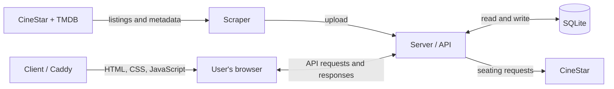

# BetterCinestar

BetterCinestar is a web app for browsing CineStar films and showtimes, filtering by cinema and date, and viewing seating availability. It combines CineStar listings with TMDB metadata such as ratings, posters, cast, and trailers.

## How it works

| Part | Responsibility | Technology |
| --- | --- | --- |
| `client/` | Builds the interface that runs in the user's browser. In Docker, Caddy serves its built files. | Svelte 5, SvelteKit, Tailwind, Vite |
| `server/` | Provides the HTTP API, stores listings, and fetches seating on demand. | Node.js, Express, Sequelize, SQLite, Puppeteer |
| `scraper/` | Fetches CineStar listings, adds TMDB metadata, and uploads results to the server. | Node.js, Puppeteer, Axios, cron |
| `shared/` | Keeps cinema IDs, names, and cities consistent across all three apps. | JSON |



SQLite is managed by the server. Listings are refreshed by the scraper, not when someone opens the website.

## Run locally with Docker

Use this path to run the packaged application. For automatic updates while editing code, see [Develop locally](#develop-locally).

Requires Docker with Compose and a running Docker engine. Run commands from the repository root in Bash or a compatible shell.

### 1. Prepare settings

On your first setup, copy the example file:

```bash
cp .env.example .env
```

If `.env` already exists, edit it instead of overwriting it. Set a private, nonempty `SCRAPER_SECRET`; the default placeholders are rejected and Compose requires this setting. Add `TMDB_API_KEY` to enable TMDB enrichment; without it, CineStar data can still be collected, but TMDB metadata will be missing.

### 2. Start the server and interface

```bash
docker compose -f docker-compose.yml -f docker-compose.local.yml up --build -d
```

`-d` runs the services in the background.

- Website: [http://localhost:8080](http://localhost:8080)
- API health: [http://localhost:3000/api/health](http://localhost:3000/api/health)

A fresh database has no films yet. Populate it in the next step.

The local override supplies the browser-accessible ports and local API address.

### 3. Populate the database

```bash
docker compose -f docker-compose.yml -f docker-compose.local.yml run --build --rm scraper
```

The scraper waits for the server healthcheck, fetches and uploads listings, then exits. Look for `Scrape task completed successfully` and refresh the website. `--rm` removes the temporary container.

Repeat this command to refresh listings. Local scraping runs once; it is not scheduled.

### 4. Inspect or stop the application

```bash
# Show container status.
docker compose -f docker-compose.yml -f docker-compose.local.yml ps --all

# Follow server and client logs; Ctrl+C stops following, not the containers.
docker compose -f docker-compose.yml -f docker-compose.local.yml logs -f server client

# Stop and remove the local services, including a profile-started scraper.
docker compose -f docker-compose.yml -f docker-compose.local.yml --profile scraper down
```

Redact secrets before sharing server logs.

`down` preserves the database volume. Adding `--volumes` deletes it and its data.

After source-code changes, repeat the `up --build -d` command. The Docker setup copies code into images; it does not automatically pick up edits from your working directory.

## Develop locally

Use Node.js 24 and npm (`.nvmrc` selects the major version). Puppeteer downloads browser binaries during installation and needs compatible OS libraries. The Docker images supply those libraries.

Native server installs also require Python 3, `make`, and a C++ compiler: SQLite is built from source for compatibility with Ubuntu 22.04 and Debian Bookworm. The server Docker image includes this toolchain. On Debian/Ubuntu, install it with `sudo apt-get install python3 make g++` if it is missing.

Avoid running this server and the Docker server simultaneously on port 3000.

### 1. Install dependencies and prepare settings

```bash
npm ci --prefix server
npm ci --prefix scraper
npm ci --prefix client

# First setup only: do not overwrite existing .env files.
cp server/.env.example server/.env
cp scraper/.env.example scraper/.env
cp client/.env.example client/.env
```

Edit these files:

- Set the same `SCRAPER_SECRET` in `server/.env` and `scraper/.env`.
- Keep `SERVER_API_URL=http://localhost:3000/api/v1/scrape-results` in `scraper/.env`; add `TMDB_API_KEY` if you want enrichment.
- Keep `PUBLIC_API_URL=http://localhost:3000` in `client/.env`.

### 2. Start the server and client in separate terminals

Server:

```bash
npm run dev-server
```

Wait for `Database synchronized successfully` or `Database recreated and schema version set` in its output. Nodemon restarts the server when its watched files change.

Client, in a second terminal:

```bash
npm run dev-client
```

Open the local URL printed by Vite, normally [http://localhost:5173](http://localhost:5173). Vite updates the interface as you edit frontend code. Stop each process with Ctrl+C.

### 3. Fetch listings once

In a third terminal:

```bash
RUN_MODE=once npm run scrape
```

Keep `RUN_MODE=once`: the example `.env` defaults to scheduled mode without an immediate scrape.

Docker and native development use separate databases by default. Populating one does not populate the other.

## Configuration

| Mode | Settings source |
| --- | --- |
| Docker Compose | Root `.env`, through the variables referenced in the Compose files. |
| Native development | `server/.env`, `scraper/.env`, and `client/.env`. |

App-specific `.env` files are excluded from Docker builds. Adding a variable to the root `.env` only affects containers if Compose passes it through.

`PUBLIC_API_URL` is embedded during the client build. For Docker, change `build.args.PUBLIC_API_URL` in the Compose configuration; setting it in the root `.env` alone has no effect. Its value must be reachable from the user's browser, which cannot resolve Docker's internal `server` hostname.

Server and scraper settings are read at startup. After changing their Compose environment values, use `up -d` to recreate affected containers; `restart` alone does not apply them.

See [server/.env.example](server/.env.example) and [scraper/.env.example](scraper/.env.example) for additional settings, including browser limits, caching, and scheduling.

## Data and persistence

| Mode | Database location |
| --- | --- |
| Docker | `/app/data/Database.sqlite` inside the server, backed by the named volume `server_sqlite_data` (usually prefixed with the Compose project name). |
| Native | `server/Database.sqlite`, unless `SQLITE_STORAGE` overrides it. |

For an offline backup, stop the server cleanly and copy the database to separate storage. In Docker, back up the named volume while the server is stopped.

Current database initialization can destroy data:

- `FORCE_DB_RESET=true` drops and recreates tables on every server startup.
- A `DB_SCHEMA_VERSION` different from the version stored in the database also drops and recreates tables. This is a reset mechanism, not a data-preserving migration.
- Removing the Docker volume, including through `down --volumes`, removes the Docker database.

Back up data before schema changes. Keep the existing `DB_SCHEMA_VERSION` when upgrading an existing database unless a full reset is intended.

## Checks and troubleshooting

These checks are available after installing native dependencies:

```bash
npm run check --prefix client    # Svelte and TypeScript checks
npm run lint --prefix client     # Formatting and lint checks
npm run build-client             # Production frontend build
npm test --prefix scraper        # TMDB matching tests using local fixtures
```

Check that the API responds:

```bash
curl -f http://localhost:3000/api/health
```

Expect JSON with `status: "OK"`.

| Symptom | What to check |
| --- | --- |
| Website opens but has no films | Run the one-off scraper; verify upload success. Also check selected cinemas/date: valid filters can have no upcoming performances. |
| Website cannot reach the API | Check `/api/health` and the client API address. Use both Compose files locally; rebuild the client after changing its build argument. |
| Scraper sits waiting | It may be in scheduled mode. Use `RUN_MODE=once npm run scrape` for an immediate native run. |
| Upload returns `401` | Server and scraper have different `SCRAPER_SECRET` values. |
| No TMDB metadata | Check `TMDB_API_KEY` and scraper warnings. CineStar collection can succeed without enrichment. |

## Deployment

The base [docker-compose.yml](docker-compose.yml) starts all three services. Its scraper runs at startup and daily at 02:00 in the container's timezone.

For public hosting:

- Configure domain routing and HTTPS through your hosting platform or reverse proxy, routing to client port `80` and server port `3000` on the Docker network.
- Set the client build's API address to your public API domain. It currently uses `https://api.bettercinestar.com`.
- Supply real secrets and preserve the SQLite volume with backups.

## Shared cinema catalogue

Edit [shared/cinemas.json](shared/cinemas.json) to change cinema IDs, names, or cities used by all three apps. Source notes are in [shared/cinemas-sources.md](shared/cinemas-sources.md).
